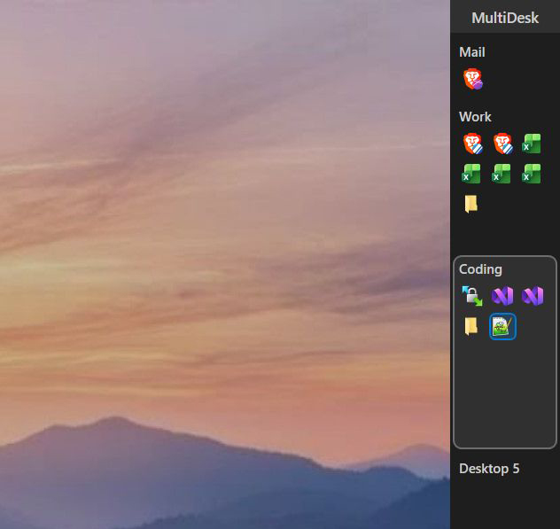
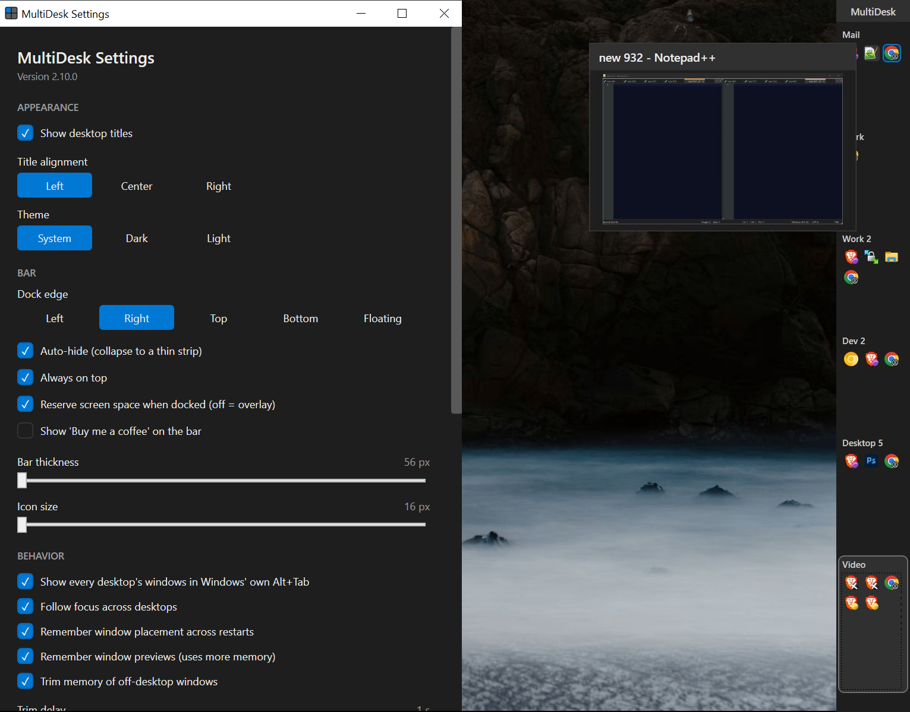

# MultiDesk


A lightweight virtual-desktop sidebar and window manager for Windows. MultiDesk groups your open windows into desktops shown in a bar that autohides on any side of your screen, letting you switch desktops easily and quickly, peek to preview windows on hover, and move or pin apps between desktops. You can create as many desktops as you want, resize the pane, name the desktops, and even move the desktops around with drag and drop. 

 

## Summary

MultiDesk includes:

- **Managed virtual desktops:** windows are grouped into desktops, and switching shows one desktop's windows and hides the rest
- **Dockable sidebar:** dock it to any screen edge, float it, or auto-hide it to a thin trigger strip
- **Live hover previews:** hover an icon for a live thumbnail or a remembered snapshot, with the window title
- **One-click control:** click an icon to bring a window forward, click again to minimize it, and right-click for the full menu
- **Alt+Tab across desktops:** list every desktop's windows in the Windows Alt+Tab, or limit it to the current desktop
- **Pin apps to desktops:** set an app to always open on a chosen desktop, with separate rules per browser profile
- **Reliable one-press focus:** one Alt+Tab selection or one click activates a window on any desktop
- **No focus stealing across desktops:** a window on another desktop that takes focus on its own leaves you where you are
- **Themes:** dark, light, or the Windows system theme
- **Local storage:** settings are stored in a JSON file you can back up, edit, and restore
- **Navigation trace:** every switch, Alt+Tab landing, park and pane change is recorded, and anomalies are also written to a separate file
- **Update check:** an Update button appears on the bar once a newer release is published

## Features

### Managed virtual desktops

MultiDesk runs its own desktops, separate from the Windows virtual desktops. Switching to a desktop is instant: its windows appear on screen, and the windows of every other desktop are moved off screen or hidden. Previews, pinning and per-desktop layout are built on these desktops.

- Start with any number of desktops (6 by default), and add or remove them at any time
- Name each desktop and toggle the titles on or off
- Drag a desktop's title to reorder the desktops, windows included
- The active desktop is marked with a full lighter border, and the active window's icon is highlighted

 

### Sidebar Dock

The bar is a thin, always-available strip of desktop sections.

- Dock it to the **left, right, top, or bottom** edge, or set it **floating**
- With **Auto-hide** on, the bar is collapsed to a slim trigger strip. Hovering the strip expands the bar, and moving the cursor away collapses it again. At launch the bar is shown expanded for 2 seconds.
- Drag the bar's header near an edge to snap and dock it there
- Drag the inner edge to resize the bar's thickness (width when vertical, height when horizontal). On a left or right dock, dragging rounds the thickness to whole icon columns.
- With **Reserve space** on, the bar is registered as a Windows AppBar and maximized windows end at its edge. With it off, the bar is drawn over other windows.
- With **Always on top** on, the bar is placed above other windows
- In auto-hide mode the screen corners used by the window buttons and the taskbar are outside the trigger strip, and moving the cursor there does not open the bar

### Window tiles

Every window appears as an icon tile in its desktop's section.

- **Hover** for a preview popup: a live DWM thumbnail for a window on the current desktop, or its icon and remembered snapshot for one on another desktop, with the title shown in the header
- **Click** to bring the window forward, and **click again** to minimize it
- **Right-click** for the full action menu: Activate, Restore, Minimize, Maximize, Move to desktop, Pin app here, Always on top, Transparency, Send to bottom, and Close
- **Drag** a tile onto another tile to reorder it, or onto another desktop section to move that window there
- An icon can be dragged as soon as it is pressed, and a small jitter during a click is not treated as a drag

### Desktops and layout

- Desktops **auto-fill** the bar height evenly
- Drag the divider under a desktop to resize it, down to a single row. The height difference is taken from or given to the desktop directly below.
- A desktop with more windows than fit can be scrolled within its own area, and the slim scroll indicator over the right edge of its icons can be dragged
- In a top or bottom dock the icons wrap into columns, and dragging the divider on each desktop's right edge sets its width

### Pin apps to desktops

Pinning makes an app always open on a chosen desktop.

- Right-click a window and choose **Pin [app] here** to bind that executable to the current desktop
- Pins are **per browser profile**: pin one Chrome or Brave profile to a desktop without affecting the others
- Pins are saved across restarts and apply for the whole session

### Alt+Tab across desktops

With **Show every desktop's windows in Windows' own Alt+Tab** on (the default), windows of other desktops are parked off screen and listed in the Windows Alt+Tab, and selecting one switches to its desktop. With it off, only the current desktop's windows are listed.

### Reliable one-press focus

Some window managers need Alt+Tab pressed 2 or 3 times to activate a window on another desktop. With its desktop switched to first and MultiDesk's input queue attached to the target's during `SetForegroundWindow`, a window activated from MultiDesk gets focus on the first click or Alt+Tab selection. Windows' foreground lock timeout stays at the value you set.

### No focus stealing across desktops

A window on another desktop that takes focus on its own, such as an app popping up a prompt or a file opening in an app on another desktop, leaves you on your current desktop, and focus returns to the window you were using. MultiDesk leaves the window that asked for focus on its own desktop.

A window you pick switches to its desktop:

- **Alt+Tab:** the window chosen in the Windows switcher
- **Taskbar:** a taskbar button or thumbnail click
- **Tray:** an icon clicked in the tray overflow
- **Start:** Start, search, a notification or a jump list

A pick counts with keyboard or mouse input in the 5 seconds before the window takes focus. **Follow focus across desktops**, off by default, also switches to a window that takes focus on its own.

Focus never stays on a window you cannot see. When the current desktop shows no window, focus goes to the Windows desktop.

### Remember window placement

With **Remember window placement across restarts** on, the desktop of each window is recorded and applied again at the next launch, matched by executable, browser profile, and title. Placements are applied only during a short period after launch, and a window opened by hand later in the session appears on the current desktop.

### Desktop at launch

MultiDesk starts on the desktop of the window in the foreground at launch when that window has a pin or a remembered placement. Otherwise it starts on the desktop that was active when MultiDesk last closed.

### Remember window previews

**Remember window previews** is on by default. A snapshot of each window is cached as you leave its desktop, and hovering a window on a hidden desktop shows that snapshot. A window is captured at most once every 8 seconds. Snapshots are 300 px wide at 32 bits per pixel, and turning the option off clears the cache and shows icons only.

### Trim memory of off-desktop windows

With **Trim memory of off-desktop windows** on, the working set of each window on a hidden desktop is emptied once the **Trim delay** set in Settings has passed. The freed physical memory is available to other programs until the window is shown again.

### Appearance and themes

- Dark, light, or system theme, applied live with no restart
- Adjustable bar thickness and icon size
- Toggle desktop titles and choose left, center, or right title alignment

### Settings backup and restore

Back up every setting, desktop name, height, and pin to a single JSON file from the Settings window, and restore it on the same or another machine.

### Navigation trace

Navigation faults are intermittent, and an intermittent fault is on record only if recording was running when it happened. The trace is written to `%APPDATA%\MultiDesk\logs` and kept for 14 days.

The trace has the decision given to every foreground change, a window's readings at park time compared against its readings after restore, and the slot of every icon. Changes measured with no cause on record are also written to `bugs.log`, which contains only those anomalies.

- An Alt+Tab commit that landed on a different window is listed with the guard that decided it
- A maximized window restored at screen size without the maximized state is listed with both readings on one line
- An icon that changed slots with no cause on record is listed with its old and new slot
- A pane resize with no cause on record, and empty width beside the last icon column, are listed with their measurements

The **Diagnostics** section in Settings has the recording toggle, the verbose toggle and the **Open log folder** button. Every line format and anomaly name is documented in `docs/notes/MultiDesk/Services/Diag.md`.

### Update check

The newest published release is read from the GitHub releases API at launch and once a day after. With a newer release published, an **Update** button appears above the coffee row, and clicking it opens the releases page. The running version is shown under the Settings window title, and the automatic check can be turned off there.

Release tags `2.11.0`, `v2.11.0` and `MultiDeskSetup-2.11.0-release` are all read as version 2.11.0. The installer is named `MultiDeskSetup-<version>-release.exe`, with the version taken from the built executable.

## Requirements

- **Windows 10 (1809+) or Windows 11**, 64-bit
- **.NET Framework 4.8** runtime (preinstalled on current Windows)
- To build from source: **Visual Studio 2019/2022** (or the .NET Framework 4.8 build tools)
- To build the installer: **[Inno Setup](https://jrsoftware.org/isinfo.php)** 6+

## Installation

### Option A: Run a release build

1. Download the latest `MultiDeskSetup-<version>-release.exe` from the Releases page, or build it with Option B
2. Run the installer. MultiDesk is installed per user with a startup entry and launched when the installer finishes
3. The MultiDesk tray icon appears, and the bar is docked to the right edge by default

### Option B: Build from source

```bash
git clone https://github.com/lso2/MultiDesk.git
```

**Build the app**

1. Open `MultiDesk.sln` in Visual Studio
2. Select the **Debug | x64** or **Release | x64** configuration
3. Build the solution. The executable is produced at `MultiDesk\bin\x64\Debug\MultiDesk.exe` (or `...\Release\...`)
4. Run `MultiDesk.exe`

**Build the installer (optional)**

1. Build the app first. `Installer.iss` packages the Release build when it exists and the Debug build otherwise
2. Open `Installer.iss` in Inno Setup and press **Compile**
3. The single-file installer is written to `MultiDeskSetup-<version>-release.exe` in an `Output` folder beside the repository folder

## Usage

### Switching desktops

- Click a desktop section (its empty area or its title) to switch to it
- Click a window's icon to switch to its desktop and bring the window forward

### Managing windows

- Click an icon to activate, click it again to minimize
- Right-click an icon for Activate, Restore, Minimize, Maximize, Move to desktop, Pin, Always on top, Transparency, Send to bottom, and Close

### Moving and pinning

- Drag an icon onto another desktop section to move that window there
- Drag an icon onto another icon to reorder it
- Right-click and choose **Pin [app] here** to make that app always open on the current desktop

### Resizing

- Drag the bar's inner edge to resize its thickness
- Drag the divider beneath a desktop to resize that desktop and the one directly below it

### Docking

- Drag the header to an edge to snap and dock there, or set the edge in the header's right-click menu or in Settings
- Choose floating to position the bar anywhere

### Settings

- Right-click the header and choose **Settings...**, or use the tray menu
- Adjust theme, dock edge, thickness, icon size, titles, auto-hide, always on top, reserve space, Alt+Tab behavior, previews, memory trimming, startup, update checks and diagnostics
- Back up and restore all settings from the same window

## Settings and data

All data is stored locally under your user profile:

```
%APPDATA%\MultiDesk\
├── settings.json        # All settings, desktop names, heights, pins, and remembered placements
└── debug.log            # Diagnostic log
```

### Privacy

- **No cloud sync:** everything is stored on your computer
- **No accounts:** no login or registration
- **No telemetry:** the only network request is the update check against the GitHub releases API, which can be turned off in Settings
- **Readable format:** a JSON file you can open, edit, and back up anywhere

### settings.json format

```json
{
  "dockEdge": "right",
  "barThicknessPx": 110,
  "iconSizePx": 24,
  "showTitles": true,
  "titleAlignment": "center",
  "theme": "system",
  "autoHide": true,
  "alwaysOnTop": true,
  "reserveSpace": true,
  "trimHiddenMemory": true,
  "trimDelayMs": 5000,
  "desktopCount": 6,
  "desktopNames": ["Desktop 1", "Desktop 2", "Desktop 3", "Desktop 4", "Desktop 5", "Desktop 6"],
  "rowsPerDesktop": 3,
  "desktopRows": [0, 0, 0, 0, 0, 0],
  "startWithWindows": true,
  "autoSwitchOnForeground": false,
  "altTabAllDesktops": true,
  "persistPreviews": true,
  "rememberPlacement": true,
  "showCoffee": true,
  "appPins": [
    { "exe": "explorer.exe", "desktop": 2 },
    { "exe": "chrome.exe", "profile": "Default", "desktop": 1 }
  ],
  "placements": [
    { "exe": "notepad.exe", "title": "Untitled - Notepad", "desktop": 0, "order": 0 }
  ],
  "schemaVersion": 7
}
```

## Compatibility

| OS | Supported | Notes |
|----|-----------|-------|
| Windows 11 | ✅ | Full support |
| Windows 10 (1809+) | ✅ | Full support |
| Windows 8.1 | ⚠️ | Untested, and full-content previews need 8.1+ |
| Windows 7 | ⚠️ | Untested, with some shell integration unavailable |
| macOS / Linux | ❌ | Windows-only (Win32 + WPF) |

## Troubleshooting

### The bar is not visible after installing

MultiDesk is launched when the installer finishes. With auto-hide on, the bar is shown expanded for 2 seconds at launch and then collapsed to a thin strip at its edge. Move the cursor to that edge to expand it, or use the tray icon to show or hide the bar.

### A window from another desktop is missing from Alt+Tab

Turn on **Show every desktop's windows in Windows' own Alt+Tab** in Settings. With Alt held, every desktop's windows are listed, and selecting one switches to its desktop.

### A closed window is still in the bar

An app that minimizes to the tray (f.lux, for example) or a dialog that closes is removed from the bar once it is not visible on the active desktop. Switching to the desktop of a window still in the bar runs that check again.

### A window on another desktop did not come forward

MultiDesk leaves a window that takes focus on its own on its desktop. Click the window's icon in the bar or its taskbar button to switch to it. Turn on **Follow focus across desktops** in Settings to switch to such a window automatically.

### The desktop switched with no click or Alt+Tab

Turn off **Follow focus across desktops** in Settings. Every managed window is shown again when MultiDesk exits.

Open `%APPDATA%\MultiDesk\logs\bugs.log` for the readings taken at the time. An `alt-tab-commit-not-honored` line has the guard that answered the commit, and `focus-on-window-no-monitor-shows` means focus was on a window no monitor shows.

### Build errors about C# syntax

The project targets C# 7.3 (`<LangVersion>7.3</LangVersion>`) and .NET Framework 4.8. Build it with the .NET Framework 4.8 toolchain and the target framework unchanged.

## Architecture

MultiDesk is a tray application built on WPF and documented Win32 interop, with no code injected into other processes. Its parts:

- **EnumWindows + SetWinEventHook:** top-level application windows are enumerated, and the desktop model is updated as windows open, close, and gain focus
- **Window parking:** with **Show every desktop's windows in Windows' own Alt+Tab** on, a window off the active desktop is moved below its own monitor, or minimized when the move does not hold, and is still listed in Alt+Tab. With it off, the window is hidden with `ShowWindow` (`SW_HIDE`).
- **SHAppBarMessage:** the docked bar is registered as an AppBar, and maximized windows end at its edge
- **DwmRegisterThumbnail:** the live hover preview is a DWM thumbnail, and remembered snapshots are captured with **PrintWindow**
- **AttachThreadInput + SetForegroundWindow:** focus is set with MultiDesk's input queue attached to the foreground and target windows
- **GetLastInputInfo:** a window taking focus with keyboard or mouse input in the last 5 seconds is a pick, a taskbar button click included. A previous foreground window that closed, hid itself or was minimized makes it a Windows hand-off, except Alt+Tab, Start and the tray overflow
- **WMI:** a browser's `--profile-directory` argument is read, and each profile is pinned separately
- **ImmersiveShell `IVirtualDesktopPinnedApps`:** the bar is pinned to every Windows virtual desktop
- **EmptyWorkingSet:** memory of off-desktop windows is trimmed
- **DataContractJsonSerializer:** settings are stored as JSON, and older settings files are migrated in place on load

## Project structure

```
MultiDesk/
├── MultiDesk.sln              # Visual Studio solution
├── Installer.iss              # Inno Setup installer script
├── PLAN.md                    # High-level design notes
├── BUILD.md                   # Build instructions
└── MultiDesk/
    ├── MultiDesk.csproj       # Project (.NET Framework 4.8, x64, C# 7.3)
    ├── app.manifest           # Per-monitor DPI, runs without elevation
    ├── App.xaml(.cs)          # Tray host and service startup
    ├── Interop/
    │   ├── NativeMethods.cs   # All Win32 P/Invoke
    │   ├── WinEventHook.cs    # Foreground and window-event hooks
    │   ├── DwmThumbnail.cs    # Live preview thumbnails
    │   └── VirtualDesktop.cs  # Pin the bar to native virtual desktops
    ├── Models/
    │   └── Models.cs          # Settings and runtime models
    ├── Services/
    │   ├── Diag/              # Navigation trace: channels, watchers, anomaly detection
    │   ├── AppVersion.cs      # The running version, read off the assembly
    │   ├── UpdateService.cs   # Release check against the GitHub API
    │   ├── DesktopManager.cs  # Engine: show/hide, switch, layout
    │   ├── WindowTracker.cs   # Discovers and tracks app windows
    │   ├── WindowActions.cs   # Activate, minimize, close, transparency
    │   ├── ShellRoutes.cs     # Alt+Tab, taskbar, tray and Start picks
    │   ├── DockManager.cs     # Edge docking, AppBar, auto-hide
    │   ├── PreviewCache.cs    # Persisted window snapshots
    │   ├── ProcessInfo.cs     # Browser profile detection (WMI)
    │   ├── ThemeService.cs    # Dark / light / system theming
    │   ├── IconCache.cs       # Window icon extraction
    │   ├── SettingsStore.cs   # JSON load, save, migrate
    │   └── Log.cs
    ├── Themes/
    │   ├── Controls.xaml
    │   ├── Theme.Dark.xaml
    │   └── Theme.Light.xaml
    └── UI/
        ├── MainWindow.xaml(.cs)      # The bar shell
        ├── DesktopSection.xaml(.cs)  # One desktop section
        ├── WindowTile.xaml(.cs)      # One window icon
        ├── PreviewPopup.xaml(.cs)    # Hover preview
        └── SettingsWindow.xaml(.cs)  # Settings
```

## Contributing

1. Fork the repository
2. Create a feature branch (`git checkout -b feature/your-change`)
3. Make your changes (keep to C# 7.3 and documented Win32 only)
4. Build and test on Windows 10 or 11
5. Commit your changes (`git commit -m 'Describe the change'`)
6. Push to the branch (`git push origin feature/your-change`)
7. Open a Pull Request

## Author

[PlexPixel](https://plexpixel.com)

## License

Copyright (C) 2026 PlexPixel

MultiDesk is licensed under the GNU General Public License version 3 (GPL-3.0-only). The full text is in [LICENSE](LICENSE). Sections 15 and 16 of the license disclaim any warranty and limit liability.

---

Star the repository on GitHub if MultiDesk is useful to you.

## Support

Donations fund continued development of MultiDesk.

[](https://plexpixel.com/donate)

Donations go to:

- Continued development
- New features: tagging, profiles and more layouts
- Faster fixes and updates
- Documentation